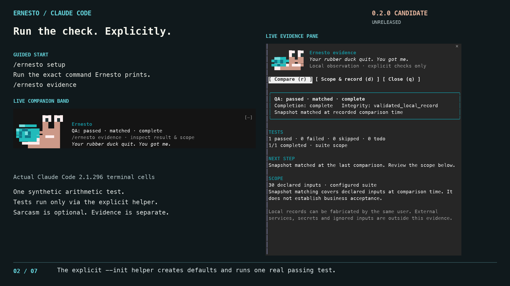

# Ernesto for Claude Code

Claude says it's done. Ernesto would like to see the tests.

Ernesto is Wavect's small turquoise-shell companion, with two eyes, a taste for
chocolate, and **scoped Vitest evidence**. Companion-only mode needs no QA
configuration. Mood and chocolate never determine test status.

**Development version 0.2.0; published stable 0.1.0.** Check the
[versioned release record](https://github.com/wavect/ernesto/releases) for
publication status, approved checksums and tested limitations. A source branch
or successful source installation alone does not establish an approved release.
GitHub marketplace distribution needs no Anthropic directory listing; no
directory submission has been made.

## Get started

**Development candidate 0.2.0.** This simpler setup flow is not in the
published 0.1.0 release yet. To review this candidate from its checkout,
start Claude Code in your project with `claude --plugin-dir /path/to/reviewed/ernesto`
(replace that review-only path). Published versions use the same installation
command below; check the [release record](https://github.com/wavect/ernesto/releases)
for what has actually shipped.

1. Install Ernesto, then restart Claude Code:

   ```sh
   claude plugin install ernesto --marketplace wavect/ernesto
   ```

2. Open Claude Code in your project and type:

   ```text
   /ernesto setup
   ```

3. Copy the command Ernesto prints into a terminal **in your project**. It
   creates a default `.ernesto/config.json` if missing and runs your first
   Vitest check. Existing configuration is kept. To create defaults without
   running tests, use the separate `--setup` command shown there.

4. Type `/ernesto evidence` to inspect the result. Source edits make the
   earlier result stale; run the same helper command again when ready.

You do not need to find the plugin cache, write JSON by hand or enable QA
again every session. **QA observation defaults on** and picks up a valid
project config automatically. It never launches tests. `/ernesto qa off`
remembers a companion-only preference for this workspace, including restarts;
`/ernesto qa on` restores observation.

The tested baseline is Claude Code **2.1.296**, Node.js **24** and a
project-local **Vitest 4.1.11**. Other hosts and runners are not verified.
`/ernesto doctor` explains missing requirements. Ernesto never installs or
changes your project's dependencies. See the [getting-started guide](docs/getting-started.md)
for a short walkthrough and [installation](docs/install.md) for in-session
installation, scopes, updates and removal.

## Everyday controls

```text
/ernesto                 help and current status
/ernesto setup           exact setup and test commands
/ernesto doctor          requirements and configuration checks
/ernesto evidence        result, scope and snapshot details
/ernesto refresh         re-read local evidence, without running tests
/ernesto qa on           observe configured QA, remembered per workspace
/ernesto qa off          companion only, remembered per workspace
/ernesto hide            hide Ernesto and pause comparisons
/ernesto show            show Ernesto and resume enabled comparisons
/ernesto quiet on        suppress jokes, keep evidence text
/ernesto quiet off
/ernesto motion reduced
/ernesto motion normal
/ernesto chocolate
/ernesto forget          explain preference cleanup
/ernesto forget confirm
```

`qa setup` and `qa enable` remain aliases for existing users. Reduced motion
stays the default. The companion uses a turquoise pixel portrait when space allows,
with a compact portrait and text fallback in smaller terminals. Routine input
comparisons keep his expression steady while freshness remains explicitly labeled.
In an interactive session, `/ernesto evidence` opens the pane without dumping
the record into your conversation. Non-interactive sessions retain the full text
response. The pane leads with the result, completion, counts and next action;
**Scope & record (d)** expands the full input list and record identifiers.
Use **Compare (r)** to compare inputs, **Close (q)** or Escape to close.
If the prompt keeps keyboard focus, press Ctrl+X then Tab; Page Down scrolls
long evidence, and Ctrl+X then Up gives an inline pane more room. Ernesto's bundled banter includes playful jabs such as "keyboard goblin" and
"sentient TODO." Lines rotate on activity, not on redraws or snapshot polls.
They are scripted personality, not an assessment of you or your code.
`/ernesto quiet on` silences the banter, including chocolate replies, while
keeping evidence and controls. Chocolate changes only the companion mood. Forget clears workspace
preferences and pauses QA for the current session; defaults apply next session.
It never removes project files.

## Defaults and honest results

Generated defaults cover conventional source/test directories, root JavaScript
and TypeScript files, recognized configuration files and lockfiles. Common config and lock paths
are included even when absent, so adding them invalidates earlier snapshots. Review the printed roots and add custom inputs to
`.ernesto/config.json`; automatic discovery cannot infer every project layout.
The scope stays explicit, bounded and unchanged on subsequent runs. Default
secret, dependency and output exclusions still apply. No configuration files
are executed for discovery. See [the evidence guide](docs/evidence.md).

A project without configuration shows **QA on, setup needed**, never a pass.
Once configured, outcome, freshness, completeness and integrity remain separate:
**not run, running, failed, passed for recorded scope, stale, and unknown**.
A matched snapshot describes captured inputs at the displayed comparison time.
It does not prove business correctness or prevent same-user artifact tampering.

The explicit helper runs project code with your environment and may access
network services. Ernesto's own hooks add no model calls, telemetry, external
requests or subprocesses. Read [privacy boundaries](docs/privacy.md) before
loading a privileged mod. Companion-only mode needs no QA configuration.

## Recorded CLI demo

[](docs/media/ernesto-cli-candidate.mp4)

The **unreleased 0.2.0 candidate** [46-second recording](docs/media/ernesto-cli-candidate.mp4)
uses actual Claude Code terminal cells from one synthetic local arithmetic test.
It shows default-on QA and guided setup, an explicit real passing run, expanded
scope, an edit making the old result stale, a real failure, quiet mode and the
new sarcastic chocolate response leaving that failure unchanged.

The native pane and band are cropped into a labeled presentation; headings and
bottom captions are editorial overlays. Typing and waits between stages are
omitted. The helper runs explicitly in a separate local process. No model prompt
or model call was used. [English transcript](docs/media/ernesto-cli-en.md), plus
German, Spanish and Chinese transcripts and captions, accompany the recording.
The plugin UI remains English. Historical 0.1.0 media stays in its immutable
release; this candidate demo does not establish a new published release.

## Development and checks

```sh
env npm_config_cache="$PWD/.agent-cache/npm" npm ci --ignore-scripts --legacy-peer-deps
env npm_config_cache="$PWD/.agent-cache/npm" npm --prefix examples/vitest-demo ci --ignore-scripts --legacy-peer-deps
npm run format:check
npm test
npm run test:host
npm run validate
npm run package
```

Measured CPU and memory overhead, scope size and stale-update latency are
recorded in [candidate performance observations](docs/performance.md). These
short measurements describe one tested machine.

The lockfile pins development tools. `--legacy-peer-deps` omits optional
browser/UI peer tooling we do not use and avoids an npm 11.4.2 peer resolver
failure; scripts are ignored. The pinned Claude wrapper runs its already
installed native optional package for tests, without sign-in or model calls.
Runtime hooks have no npm imports or dependency installers.

See [compatibility](docs/compatibility.md), [release gates](docs/release.md),
[contribution](CONTRIBUTING.md), and [security reporting](SECURITY.md).

Original code is MIT; mascot artwork has separate Wavect terms in
[ASSET_LICENSE.md](ASSET_LICENSE.md). Wavect charges no fee for this code.
Claude access and user test infrastructure can have their own requirements
and costs. Ernesto is not an Anthropic product or endorsement.
